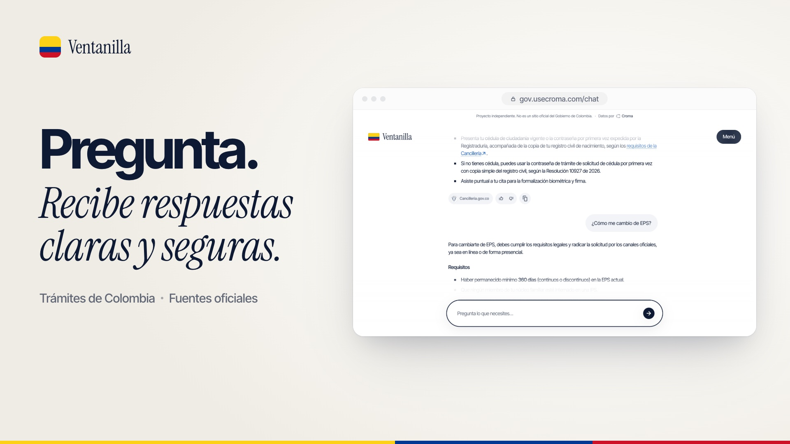

# Ventanilla

Answers about government services, from official sources only.

🇨🇴 [gov.usecroma.com](https://gov.usecroma.com) · 🇸🇻 [sv.usecroma.com](https://sv.usecroma.com) · Sources by [Croma](https://docs.usecroma.com) · Not an official government site.



## Run

```bash
npm install
cp .env.example .env.local   # add CROMA_API_KEY and GROQ_API_KEY
npm run dev
```

Requires Node 24.

## How it works

1. Search official sources.
2. Draft an answer.
3. Check every claim against the sources.
4. Answer with only what was confirmed, and cite it.

## Privacy

No cookies, no analytics, no tracking. Personal data like ID numbers and phones is blocked before it's sent. More in [SECURITY.md](SECURITY.md).

## Add a country

Each country lives in `src/countries/<code>/`: copy, sources, privacy detectors, trámite guides and `brand/` (mark, favicon, OG image). Photos go in `public/hero/<code>/` and agency icons in `public/icons/<code>/` (`COUNTRY=<code> npm run icons`). Build with `COUNTRY=<code>`.

| Country | Code | Sources |
| --- | --- | --- |
| Colombia | `co` | gov.co, Función Pública, Corte Constitucional, DIAN, SUIT corpus |
| El Salvador | `sv` | gob.sv, Simple.sv, Asamblea Legislativa, Corte Suprema de Justicia |

## Contributing

[CONTRIBUTING.md](CONTRIBUTING.md)

## License

[MIT](LICENSE). Entity names and icons belong to their entities.
